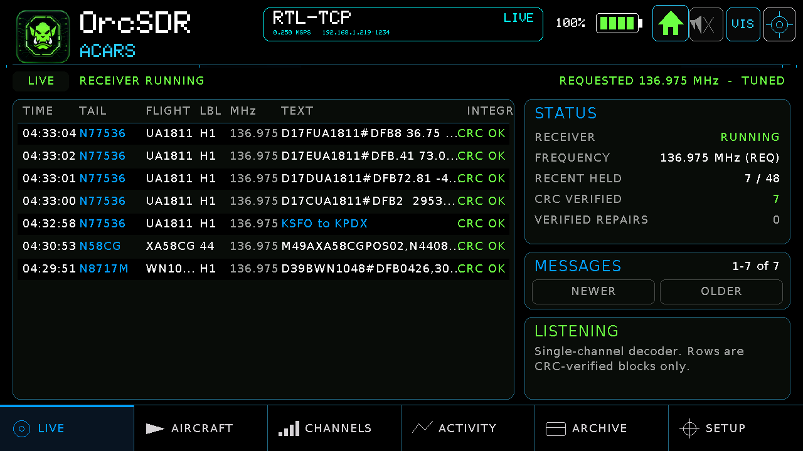
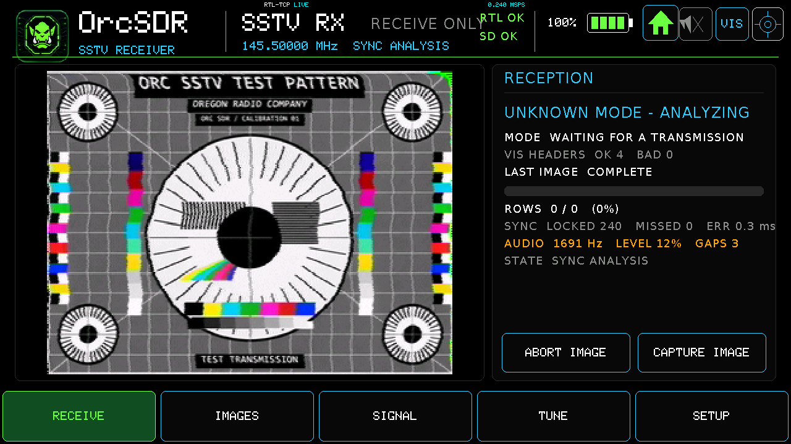
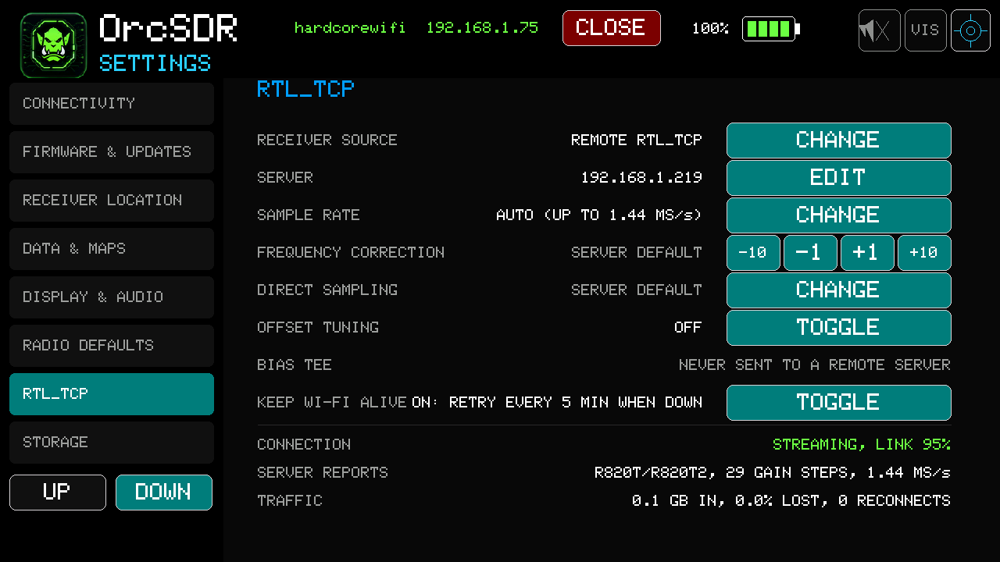
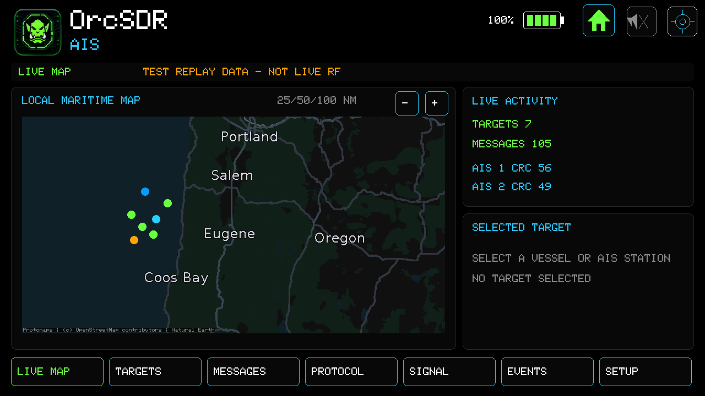
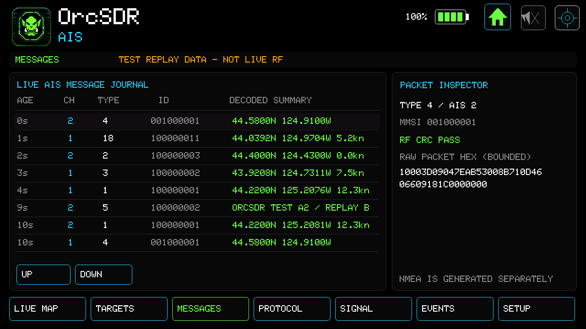

# OrcSDR v0.6.0

OrcSDR 0.6.0 adds network receivers, a marine AIS dashboard, E4000/Nooelec NESDR SMArt XTR support, and larger audio controls. It also improves aircraft-message interpretation, FT8, receiver recovery, and existing dashboards.

## E4000 and Nooelec NESDR SMArt XTR

- Added receiver identification, supported tuner gain steps, and hardware offset tuning when the receiver reports support.
- Dashboards show E4000 tuning limits and reject tuning requests outside the supported range.
- Updated the pinned esp-rtl-sdr driver to v0.9.6, including E4000 integration and receiver-startup fixes.

Receiver coverage follows the tuner's native range; some dashboard frequencies are outside that range.

References: [#229](https://github.com/hardcoreerik/OrcSDR/pull/229), [#233](https://github.com/hardcoreerik/OrcSDR/pull/233), [#240](https://github.com/hardcoreerik/OrcSDR/pull/240).

## Network receivers with rtl_tcp

Receive from a standard rtl_tcp server, such as a Raspberry Pi with an RTL-SDR, or share the Tab5's own dongle through its optional server.

- Added Settings > RTL_TCP for source selection, server address, sample-rate cap, frequency correction, direct sampling, offset tuning, and connection status.
- Remote tuner capabilities drive the available gain controls, even without a locally attached dongle.
- Added adaptive streaming rates, busy-server handling, reconnect attempts, and Wi-Fi recovery.
- Improved buffering for processing stalls and large server bursts.
- Reset retained tuner settings on new connections and corrected stale manual gain when returning to automatic gain.
- Fixed remote FT8 and Shortwave tuning that incorrectly used the local receiver's centre frequency.
- The Tab5 server is disabled by default and refuses all-interface binds. Remote bias-tee control is not offered.

Recorded checks include real FT8 reception, seven CRC-verified ACARS messages from three aircraft, and a Robot 36 SSTV replay. Real FT8 was also decoded across a cellular internet connection through an SSH relay. These results apply to the recorded setups; they do not establish every mode or control on every server.

*ACARS reception through a remote rtl_tcp receiver.*

*Robot 36 SSTV replay carried over an internet connection; this image does not represent live over-the-air SSTV reception.*

*Remote receiver settings, including Wi-Fi keep-alive.*

The rtl_tcp protocol has no authentication. Use a trusted network or secure tunnel. Remote ADS-B decoding and some tuner controls still lack completed real-signal validation in the records reviewed.

Reference: [#240](https://github.com/hardcoreerik/OrcSDR/pull/240).

## Marine AIS dashboard

- Receive both AIS channels, 161.975 and 162.025 MHz, from a single 240 kS/s stream centred at 162.000 MHz.
- Use either a USB dongle or a remote rtl_tcp source.
- Browse seven pages covering the map, targets, messages, protocol, signal, events, and setup.
- View supported positions, vessel identities, call signs, destinations, movement, and navigation information.
- Added receiver status, replay-testing, and benchmark serial commands.

*AIS map with test replay targets. The screen explicitly identifies the data as replay, not live RF.*

*AIS message journal and packet inspector using test replay data.*

On-device replay decoded all 43 expected packets with none missing or extra. Recorded checks also covered a 15-minute replay soak, source switching, repeated dashboard visits, and shared dashboard behavior.

Real ship reception and sensitivity remain unverified. Message interpretation varies by type. One initial USB test recorded lost samples that were not reproduced in later checks.

Reference: [#245](https://github.com/hardcoreerik/OrcSDR/pull/245).

## Audio controls and navigation

- Enlarged the volume tray, with a slider, percentage display, and mute control immediately below the status bar.
- Draws above dashboards while holding underlying scopes and waterfalls still.
- Prevents tray touches from reaching dashboard tuning controls.
- Mute responds once per press; holding the slider continues adjustment.
- Rearranged header controls and moved Visualizer into All Dashboards.
- Serial UI status now includes volume, audio-enabled, and tray state.

The owner hand-tested these controls. Automated device checks retain intermittent failures on some dashboards whose cause is unresolved.

Reference: [#245](https://github.com/hardcoreerik/OrcSDR/pull/245).

## FT8 and OrcDial

- Fixed a sample gap causing every subsequent FT8 slot to be rejected.
- Fixed remote band changes leaving the FT8 passband mistuned.
- Fixed an internal-memory leak during repeated FT8 visits.
- Added optional latest-message FT8 previews on compatible paired OrcDials through the existing secure link.
- Capability negotiation preserves compatibility with older Dials and use without a Dial.

Hardware checks demonstrated live FT8 decodes reaching a paired Dial. The preview shows the latest message rather than every station in a slot.

References: [#226](https://github.com/hardcoreerik/OrcSDR/pull/226), [#240](https://github.com/hardcoreerik/OrcSDR/pull/240).

## ACARS interpretation

Expanded interpretation of route and position fields, D-ATIS requests, and selected message-label variants. Improved registration handling and multiline formatting, with additional corpus checks. Airline-specific formats still vary; not every message is fully interpreted.

Reference: [#223](https://github.com/hardcoreerik/OrcSDR/pull/223).

## Dead Air improvements

- Added session-only temperature, humidity, and pressure charts with 1-, 6-, and 24-hour views.
- Missing readings appear as gaps; a cursor shows recorded values and elapsed time.
- Added VEIL-26 symbolic displays, including an optional Elder Futhark presentation.

Dead Air and ENV III support predate this release. History is held in memory for the current session and is not saved to SD. VEIL-26 presents symbolic interpretations, not scientifically validated paranormal detection. Some newer display and interaction checks remain incomplete in the feature records.

References: [#219](https://github.com/hardcoreerik/OrcSDR/pull/219), [#220](https://github.com/hardcoreerik/OrcSDR/pull/220), [#221](https://github.com/hardcoreerik/OrcSDR/pull/221).

## Recovery, maps, and documentation

- Fixed receiver cleanup when a dongle disconnects during startup.
- Applied the separate ESP-IDF USB root-port recovery patch in Tab5 builds.
- Improved recovery from prolonged Wi-Fi outages and remote-stream restart afterward.
- Improved unresolved-server and busy-server messages; rapid retuning preserves the final request.
- Nightly builds include the reviewed world overview map using the release-build layout.
- Fixed nightly configuration following ESP-Hosted configuration changes.
- Clarified P25 imports, clock setup, installation, and current receiver/decoder capabilities.
- Added Axeman72's community handheld case, bracket files, power-button extension, and assembly notes.
- Improved contribution, discussion, issue-reporting, and project-support links.

References: [#239](https://github.com/hardcoreerik/OrcSDR/pull/239), [#240](https://github.com/hardcoreerik/OrcSDR/pull/240), [#222](https://github.com/hardcoreerik/OrcSDR/pull/222), [#241](https://github.com/hardcoreerik/OrcSDR/pull/241), [#236](https://github.com/hardcoreerik/OrcSDR/pull/236), [#231](https://github.com/hardcoreerik/OrcSDR/pull/231), [#232](https://github.com/hardcoreerik/OrcSDR/pull/232), [#227](https://github.com/hardcoreerik/OrcSDR/pull/227).

[Changes since v0.5.0-beta.1](https://github.com/hardcoreerik/OrcSDR/compare/v0.5.0-beta.1...874ccc28)

## Documentation and installation

Updated AIS user-guide and wiki source pages, all seven AIS screen captures, volume-tray guidance, and serial command references in [#250](https://github.com/hardcoreerik/OrcSDR/pull/250). AIS images show labelled replay data. Wiki source files require separate publication to the wiki repository.

M5Burner installation resets saved settings, including Wi-Fi profiles and location. Use the settings-preserving installer or compatible web-flasher update path to retain settings. The embedded C6 update is optional and is not applied by installing the P4 application. Keeping C6 2.12.6 retains M5Launcher Wi-Fi/OTA; applying C6 3.0.6 stops those M5Launcher functions.
