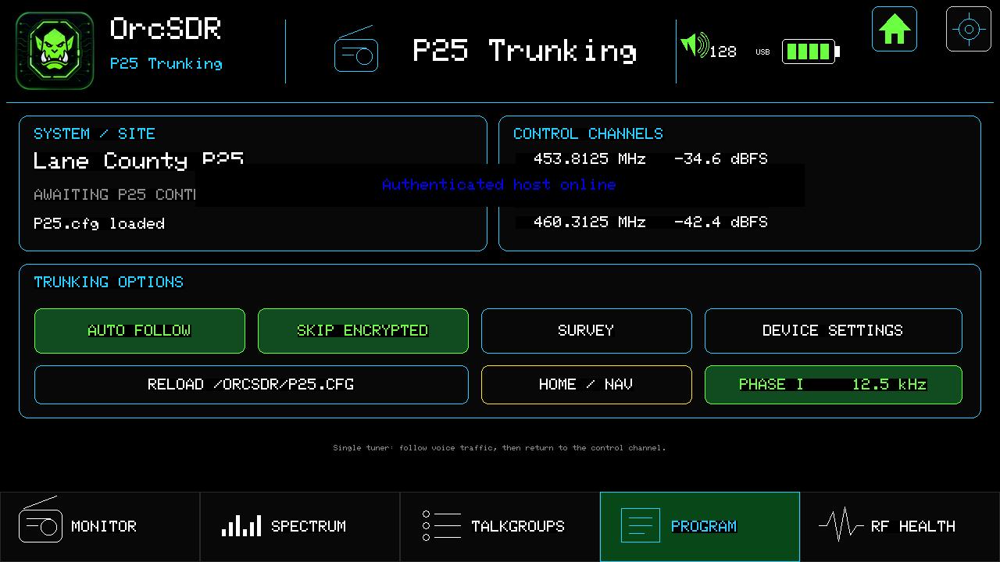

# P25

**P25 WIP — Phase I clear voice verified; wider system compatibility in progress.**

P25 is receive-only monitoring. OrcSDR follows decoded clear voice grants. On
the traffic channel it reads the LDU2 Encryption Sync field; protected audio is
muted, and **SKIP ENCRYPTED** returns the receiver to the control channel. The
dashboard may show the clear-text algorithm and key IDs for identification,
but OrcSDR does not decrypt traffic.

Phase I control and voice channels may use C4FM or linear CQPSK/LSM. The
default `auto` mode evaluates both hardware-independent demodulators during
acquisition, selects the one producing valid NIDs and TSBKs, and retries after
lock loss. RF Health shows the selected path, lock quality, timing error,
carrier error, decode rate, and frame error. A forced `cqpsk` replay of the
retained Lane County Simulcast capture decodes the recorded NAC, WACN, system,
RFSS, site, and valid TSBKs; the same strong capture currently scores better on
C4FM, so automatic mode selects C4FM for it. Wider real-world LSM and multipath
acceptance remains part of the WIP compatibility gate.

## Monitor workflow

1. Open **Systems** and select or import a local system. A clean install has no
   Lane County or other location-specific default.
2. Tap **SURVEY** to evaluate the profile's control-channel candidates. The
   button changes to **STOP SURVEY** while active; stopping returns to the
   selected control channel.
3. Wait for frame synchronization and system identity.
4. Leave **AUTO FOLLOW** enabled to follow clear voice grants.
5. Use **HOLD** to retain the displayed talkgroup. With no displayed grant it
   changes to **HOLD NEXT** and binds to the next eligible talkgroup. The
   button shows the held TGID after binding. Use **SKIP** to leave the current
   call temporarily.

Each `/orcsdr/p25/<profile-id>/profile.cfg` accepts these optional receiver
settings. Migrated version-1 profiles continue to use the defaults:

```ini
modulation=auto
cqpsk_timing_gain=0.005
cqpsk_carrier_gain=0.008
```

Use `modulation=c4fm` or `modulation=cqpsk` only for diagnosis or a site whose
waveform is known. A site being simulcast does not by itself prove that it uses
LSM.

The Talkgroups page shows recent decoded public activity. An unknown talkgroup ID is still useful evidence; OrcSDR does not invent a label when none is known.

## Systems

The Systems page manages up to 16 SD-card profiles. **Import** reads
`/orcsdr/p25-import.cfg`; **Export** writes
`/orcsdr/exports/p25-profile.cfg`; and **Delete** requires confirmation. A
legacy `/orcsdr/P25.cfg` is imported once and preserved. Signed catalog packs
may install a profile only after source and redistribution review. **Auto
Follow** and **Skip Encrypted** remain available on this page for the active
system.

## Import your first system

1. Download the [example import file](../examples/p25-import.cfg). It contains
   illustrative frequencies and talkgroups, not a ready-to-use local system.
2. Open it in a plain-text editor. Replace the system name and control-channel
   frequencies with those for your local **Phase I** system. Enter frequencies
   as whole-number **Hz**: `851012500` means 851.0125 MHz. Remove sample talkgroups
   you do not need, or replace their IDs and labels with your own.
3. With the Tab5 powered off, put the microSD card in your computer. Create an
   `orcsdr` folder at the card root if needed, and save the file inside it as
   `p25-import.cfg`. Check that your editor has not added `.txt` to the name.
4. Safely eject the card, insert it into the Tab5, and start OrcSDR. Open
   **P25 → Systems → Import**. A successful import saves and activates the profile.
5. Return to Monitor, tap **SURVEY**, and wait for synchronization. Use an
   antenna suitable for the system's frequencies. A successful import confirms
   the configuration was accepted; reception still depends on the signal and
   supported system behavior.



The file uses one `key=value` per line, without INI section headings. Blank
lines and lines starting with `#` or `;` are allowed. Use decimal numbers,
including for NAC, WACN, and system IDs if you add those optional fields;
convert hexadecimal IDs before entering them. Keep `version=2`.

Repeat `control_channel_hz` for up to **8 distinct control channels**. Optional
`talkgroup=ID,Label` lines provide up to **8 distinct aliases**; they are not
required to receive unknown talkgroups. IDs must be 1–65535, labels at most
31 ASCII characters, and the system name at most 47 ASCII characters (limits
are measured in bytes, so non-ASCII text may fit fewer characters). Leave
`modulation=auto` unless diagnosing a known waveform.

### If import fails

| Message | What to check |
|---|---|
| `missing version` | Include `version=2` on its own line. |
| `line N missing =` / `line N unknown key` | Check the indicated line for a missing equals sign, spelling, or an INI section heading. |
| `line N control channel` | Use whole-number Hz, no duplicates, and at most 8 entries. The parser accepts 24000000–1766000000 Hz; your receiver may have narrower tuning limits. |
| `line N talkgroup` | Use `talkgroup=ID,Label`, a unique decimal ID, a nonempty label, and at most 8 entries. |
| `invalid profile header` | Include a nonempty system name and at least one control channel. |
| `system identity already installed` | The same nonzero WACN/system ID and RFSS/site are already installed. Use the existing profile, or export it before deleting and replacing it. |
| `profile limit reached` | Export a profile you want to keep before deleting it to make room; the limit is 16. |

If no profile appears, also check that the card is recognized and that the
file is exactly `/orcsdr/p25-import.cfg`. **Export** provides a copy of the
selected profile at `/orcsdr/exports/p25-profile.cfg` for backup or later editing.
