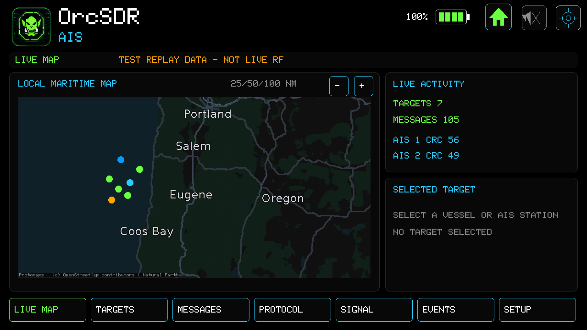
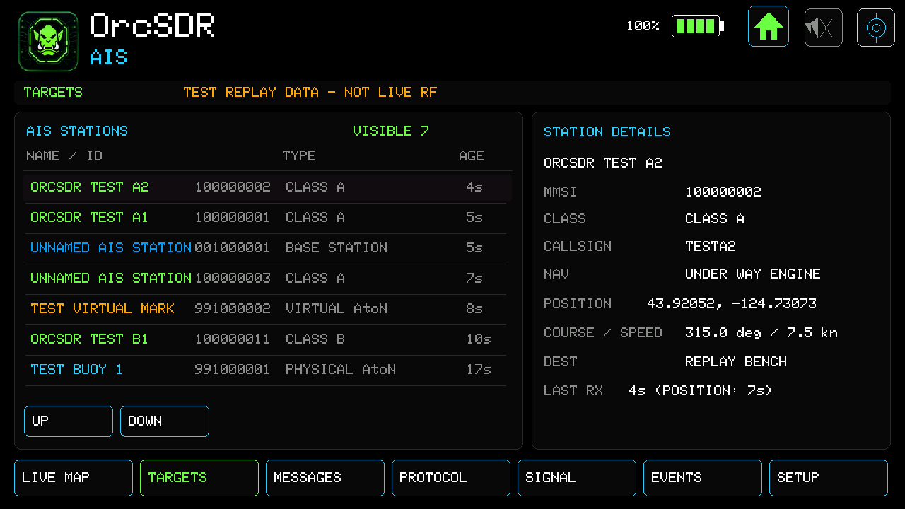
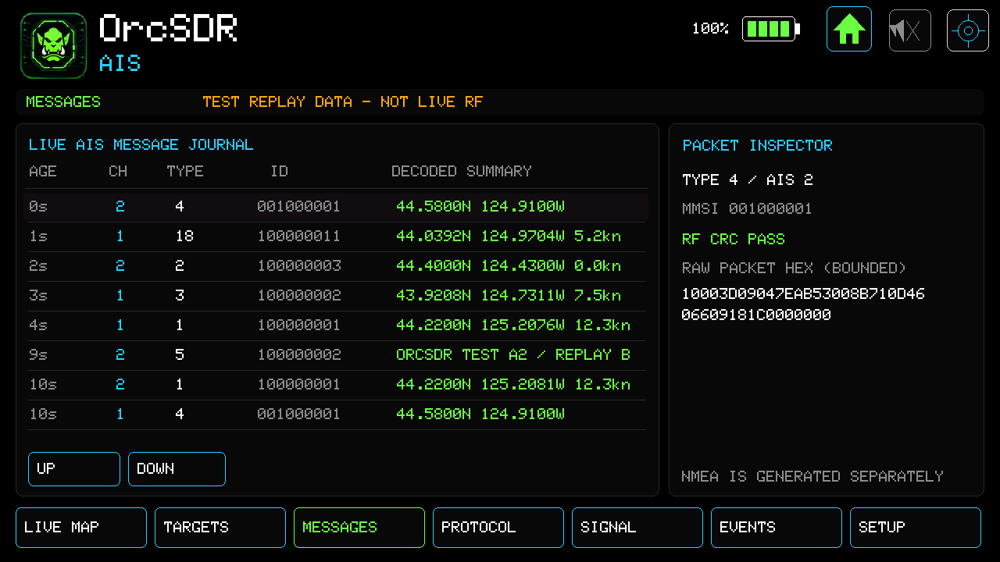
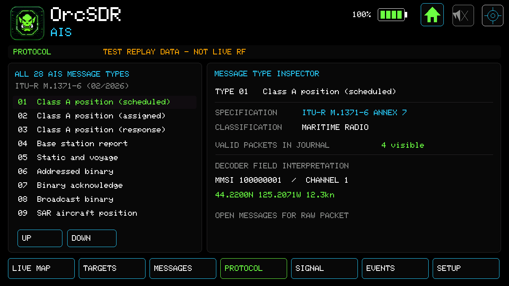
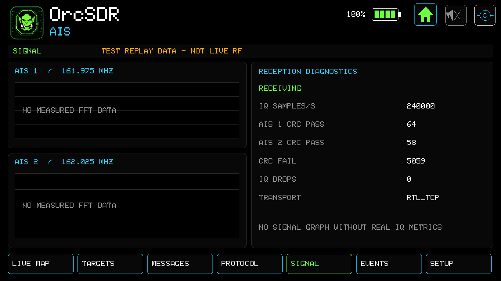
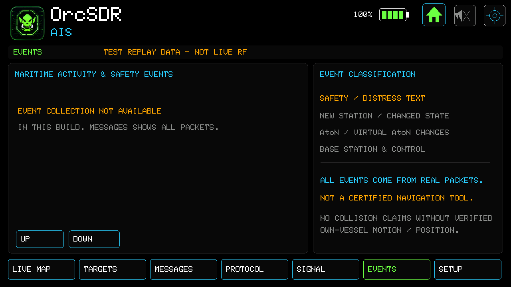
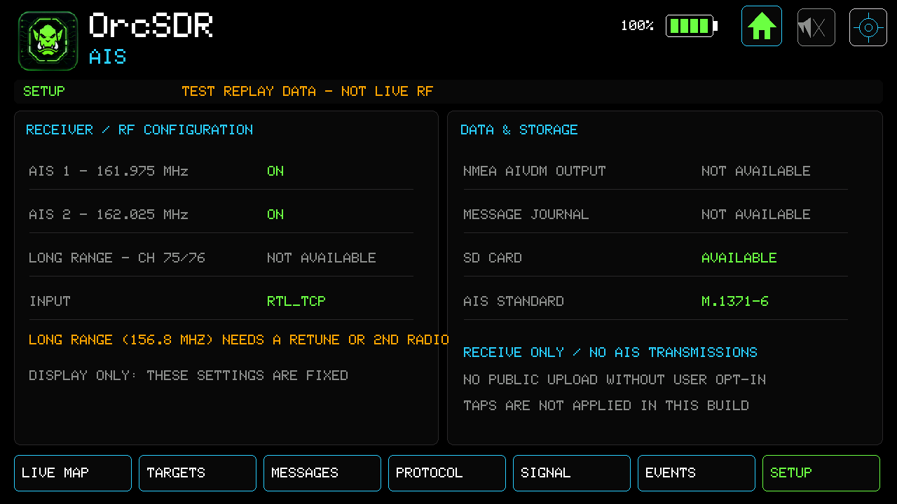

# AIS Marine Vessels

The AIS dashboard receives the VHF marine **Automatic Identification System**: ships, base stations and aids to navigation that broadcast their identity and position on 161.975 MHz (AIS 1) and 162.025 MHz (AIS 2). OrcSDR is **receive-only** here; it never transmits AIS.

> **Not a navigation tool.** The dashboard shows what the receiver decoded. It is not certified for navigation or collision avoidance, and it makes no collision claims.

## Evidence level: read this first

- **Proven:** deterministic synthetic AIS recordings, replayed over a private network connection, decode on the Tab5 byte for byte (43 of 43 transmitted packets in the documented run, with no lost samples). Every screenshot below comes from that replay and carries the orange **TEST REPLAY DATA – NOT LIVE RF** banner. The positions are invented, laid out off the Oregon coast only so the map has something to show.
- **Not yet proven:** reception of real ships. The lab receiver has so far heard only noise on these channels, so sensitivity and sustained use are unmeasured. See the [AIS integration checkpoint](https://github.com/hardcoreerik/OrcSDR/blob/main/docs/AIS_INTEGRATION_CHECKPOINT.md) for the exact record.

## Before you open it

1. Use an antenna suited to about 162 MHz (a marine VHF or an air-band/VHF whip). AIS is line of sight: expect tens of nautical miles over open water and much less from inland or behind hills.
2. Choose your receiver: a USB RTL-SDR, or an `rtl_tcp` server on your network (Settings > RTL_TCP). AIS asks for one 162.000 MHz / 240 kS/s stream and takes both channels from it.
3. Set your receiver location in Settings so the map centres on you. Without offline maps (see offline maps (see the OrcSDR user guide)) the map area shows only the targets and range scale.
4. Open **ALL DASHBOARDS** and choose **AIS** (it is on page 2). Opening AIS takes over the shared 162 MHz stream, so it closes other dashboards that use the same stream (ACARS, SSTV, FT8, Dead Air).

## The seven pages

The row of buttons along the bottom switches pages. The header shows Home, the speaker (see [[Gain and Shared Controls]]) and Settings.

### Live Map

Vessels, base stations and aids to navigation on an offline map, with live counters (targets, messages, CRC-valid packets per channel). Use **−** and **+** to change the range: 10, 25, 50 or 100 nautical miles (it opens at 25). Tap a target dot to select it.

### Targets

Every station heard, newest first, with class, type and age. Tap a row for details: MMSI, call sign, navigation status, position, course and speed, destination and when it was last heard.

### Messages

A rolling journal of valid packets: age, channel, message type, station ID and a decoded summary. Select a row to see the raw packet hex in the inspector. Use **UP** and **DOWN** to scroll.

### Protocol

All 28 AIS message types from ITU-R M.1371-6, with how many valid packets of the selected type are in the journal. Only some types are decoded to fields (position reports, base stations, static and voyage data, Class B, aids to navigation); the rest show header information only.

### Signal

Reception diagnostics: IQ sample rate, CRC-valid packets per channel, CRC failures, dropped IQ blocks and the transport (USB or RTL_TCP). **CRC FAIL counts every noise burst that looked like a packet**, so a large number on a quiet band is normal. The two spectrum panels say **NO MEASURED FFT DATA** because this build does not compute them; it will not draw a made-up graph.

### Events

Safety and activity events are **not available in this build**; the page says so rather than showing an empty list. The Messages page shows every packet.

### Setup

Shows the fixed configuration: both channels on, the input source, and what is not available yet (long range channels 75/76 need a retune or a second radio; NMEA output and the message journal file are not implemented). The settings are display only; taps change nothing.

## Test replay mode

For development and these screenshots, the firmware can mark a session as a test replay. Every page then shows **TEST REPLAY DATA – NOT LIVE RF**. The label is armed before any replayed samples arrive and is switched on only by an authenticated serial command (see the [serial reference](https://github.com/hardcoreerik/OrcSDR/blob/main/docs/API_SERIAL_CLI.md)). It never turns itself on, and live data never carries it.

## Troubleshooting

| What you see | What it usually means |
|---|---|
| TARGETS 0, MESSAGES 0 | Normal on a quiet band or with no ships in range. Check the Signal page: `RECEIVING` with a rising CRC FAIL count means the receiver works and no valid packets have arrived. |
| Receiver shown as disconnected | No receiver, or the stream was taken by another dashboard. Reopen AIS. |
| Map shows no land | Offline maps are not installed or the receiver location is unset. |
| Long range channels unavailable | Not implemented; they sit at 156.8 MHz, outside the single 162 MHz stream. |
